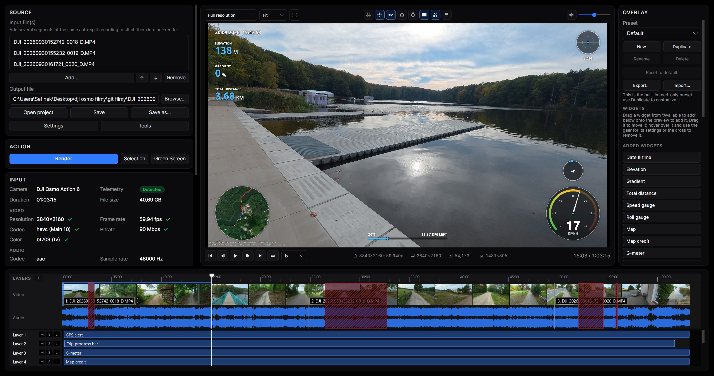

# Osmo Overlay ✨
Add a modern telemetry HUD (speed, map, route, tilt and more) to your DJI Osmo footage, straight from the data your camera already records - encoded just like the camera original, so the quality stays as close to it as a render can get.

If you find this repository useful, I would greatly appreciate it if you could give it a **star** ⭐. Thank you!
Using OsmoOverlay in your videos? A mention (e.g. in your YouTube video description) would make my day 💖
Pull requests are welcome too - bug fixes, new widgets, support for other cameras, anything that makes the app better.



## Features
- **Encoded like the original** - export settings are taken from the source, so the video matches the camera original 1:1 (codec, 10-bit color, bitrate, keyframes, timecode). Burning in an overlay always means encoding the picture once more, but at the camera's own settings the difference is practically invisible.
- **Rendered on your computer, not your phone** - unlike the overlay in DJI Mimo: no drop to 8-bit H.264 at a lower bitrate, audio untouched, no long wait with the phone unlocked and the app open, no phone as hot as an oven.
- **Joins split recordings** - the camera splits long recordings into files of about 25 minutes, and OsmoOverlay joins them into one video without breaking the route.
- **Telemetry straight from the MP4** - GPS, speed, accelerometer, ISO, shutter speed and white balance.
- **20 widgets** - including a speedometer, map, compass with route, roll and pitch, G-meter, elevation and speed charts, trip statistics, altitude, distance, date and time, and your own text or logo. Metric or imperial units.
- **Route card** - an optional summary at the start of the video: the whole route on a map, distance, speeds, elevation gain and ride time.
- **Satellite or standard map** - several built-in map sources or your own tile server.
- **Drag-and-drop editor** - position, size, fonts, colors, appear and disappear animations. Presets can be exported and shared.
- **Live preview** - with sound, playback speed control, looping, a timeline with thumbnails and saving a frame as a full-resolution PNG.
- **Cutting** - remove parts of a recording right in the app. Distance, stats and the route only count what's left.
- **Recording settings check** - shows whether the footage was recorded with the settings recommended for your camera.
- **Privacy** - the camera's serial number and GPS track don't end up in the rendered MP4 unless you turn that on.
- **HUD-only export on a green screen** - for editing in another program.
- **Tools** (no re-encoding, no quality loss):
  - **Remove metadata** - a copy that's safe to share: no GPS track, camera serial number, recording date, timecode or thumbnail.
  - **Camera microphone audio** - with an external microphone connected, the camera saves audio from its built-in microphones to a separate .AAC file that neither Vegas Pro nor Audacity opens by default. Converts to WAV or M4A.
  - **Color tag fix** - Vegas Pro can leave out the color space tag (Rec.709) when exporting to MP4, so some players show wrong colors. Highly recommended after rendering in Vegas Pro.
  - **Compare videos** - resolution, codec, color tags, bitrate and telemetry of up to 6 files side by side.
- **Automatic updates** - the app checks for new versions by itself, and on Windows (when installed with the installer) updates with one click.
- **Windows, Linux and macOS** - x64 and ARM, with a GUI and a command-line version. Only the Windows version is regularly tested and considered stable, Linux and macOS are experimental.

## Download
Every release comes in two variants for each platform:

| Variant               | .NET runtime                                                                          | Size    |
|:----------------------|:--------------------------------------------------------------------------------------|:--------|
| `self-contained`      | Included - nothing else to install                                                    | Larger  |
| `framework-dependent` | [.NET 10 Desktop Runtime](https://dotnet.microsoft.com/download/dotnet/10.0) required | Smaller |

Pick the archive for your system:

| System        | CPU                  | Installer                                                                                                                | `self-contained`                                                                                                               | `framework-dependent`                                                                                                               |
|:--------------|:---------------------|:-------------------------------------------------------------------------------------------------------------------------|:-------------------------------------------------------------------------------------------------------------------------------|:------------------------------------------------------------------------------------------------------------------------------------|
| Windows 10/11 | Intel / AMD (x64)    | [Download (exe)](https://github.com/sefinek/osmo-overlay/releases/download/v0.3.0/OsmoOverlay-0.3.0-win-x64-setup.exe)   | [zip](https://github.com/sefinek/osmo-overlay/releases/download/v0.3.0/OsmoOverlay-0.3.0-win-x64-self-contained.zip)           | [zip](https://github.com/sefinek/osmo-overlay/releases/download/v0.3.0/OsmoOverlay-0.3.0-win-x64-framework-dependent.zip)           |
| Windows 11    | ARM64 (Snapdragon)   | [Download (exe)](https://github.com/sefinek/osmo-overlay/releases/download/v0.3.0/OsmoOverlay-0.3.0-win-arm64-setup.exe) | [zip](https://github.com/sefinek/osmo-overlay/releases/download/v0.3.0/OsmoOverlay-0.3.0-win-arm64-self-contained.zip)         | [zip](https://github.com/sefinek/osmo-overlay/releases/download/v0.3.0/OsmoOverlay-0.3.0-win-arm64-framework-dependent.zip)         |
| Linux         | Intel / AMD (x64)    | -                                                                                                                        | [tar.gz](https://github.com/sefinek/osmo-overlay/releases/download/v0.3.0/OsmoOverlay-0.3.0-linux-x64-self-contained.tar.gz)   | [tar.gz](https://github.com/sefinek/osmo-overlay/releases/download/v0.3.0/OsmoOverlay-0.3.0-linux-x64-framework-dependent.tar.gz)   |
| Linux         | ARM64 (Raspberry Pi) | -                                                                                                                        | [tar.gz](https://github.com/sefinek/osmo-overlay/releases/download/v0.3.0/OsmoOverlay-0.3.0-linux-arm64-self-contained.tar.gz) | [tar.gz](https://github.com/sefinek/osmo-overlay/releases/download/v0.3.0/OsmoOverlay-0.3.0-linux-arm64-framework-dependent.tar.gz) |
| macOS         | Intel (x64)          | -                                                                                                                        | [tar.gz](https://github.com/sefinek/osmo-overlay/releases/download/v0.3.0/OsmoOverlay-0.3.0-osx-x64-self-contained.tar.gz)     | [tar.gz](https://github.com/sefinek/osmo-overlay/releases/download/v0.3.0/OsmoOverlay-0.3.0-osx-x64-framework-dependent.tar.gz)     |
| macOS         | Apple Silicon (M1+)  | -                                                                                                                        | [tar.gz](https://github.com/sefinek/osmo-overlay/releases/download/v0.3.0/OsmoOverlay-0.3.0-osx-arm64-self-contained.tar.gz)   | [tar.gz](https://github.com/sefinek/osmo-overlay/releases/download/v0.3.0/OsmoOverlay-0.3.0-osx-arm64-framework-dependent.tar.gz)   |

All files are also listed on the [latest release page](https://github.com/sefinek/osmo-overlay/releases/latest). Not sure which CPU you have? On Windows see *Settings* → *System* → *About* → *System type*; on Linux and macOS run `uname -m` (`x86_64` = x64, `arm64`/`aarch64` = ARM64).

Each package contains both the app (`OsmoOverlay`) and the command-line renderer (`OsmoOverlay.Cli`). Checksums are in `OsmoOverlay-<version>-SHA256SUMS.txt`.

### Hardware
The first-run guide checks your computer against these values for 4K renders from an Osmo Action:

| Component       | Minimum                                  | Recommended                                                                               |
|:----------------|:-----------------------------------------|:------------------------------------------------------------------------------------------|
| System          | 64-bit                                   | 64-bit                                                                                    |
| RAM             | 8 GB                                     | 16 GB or more                                                                             |
| CPU             | 4 threads                                | 8 threads or more                                                                         |
| Video encoder   | CPU (x264/x265) - works, but much slower | Graphics card: NVIDIA NVENC, AMD AMF or Intel Quick Sync (the latter two on Windows only) |
| Video decoding  | CPU                                      | GPU decoding of 10-bit HEVC (D3D11VA on Windows, VideoToolbox on macOS, VAAPI on Linux)   |
| Free disk space | 20 GB                                    | About 66 GB per hour of 4K footage (a render needs twice its size while it's made)        |

The built-in performance test (*Tools*) measures what your computer can actually do and suggests settings.

### Windows
The easiest way is the installer: `OsmoOverlay-<version>-win-x64-setup.exe` (or `win-arm64`). It installs for your account into `%LocalAppData%\Programs\OsmoOverlay`, without administrator rights, and adds desktop and Start menu shortcuts and an uninstaller. It's based on the `self-contained` variant, so nothing else is needed. An installed copy checks for new versions on startup and can update itself (also from *Settings* → *About*): it downloads the new installer, verifies it, replaces the old version and starts again.

Alternatively, extract the zip and run `OsmoOverlay.exe`.

The builds aren't code-signed yet, so SmartScreen may warn on first launch - choose *More info* → *Run anyway*.

### Linux
```sh
tar -xzf OsmoOverlay-<version>-linux-x64-self-contained.tar.gz
./OsmoOverlay-<version>-linux-x64-self-contained/OsmoOverlay
```
To add OsmoOverlay (with its icon) to your application menu, run `./install-desktop-entry.sh` from the extracted folder - `--remove` takes it out again. Run it again if you move the folder.

### macOS
Extract the archive and move `OsmoOverlay.app` to *Applications*. The app isn't signed or notarized yet, so macOS blocks the first launch - right-click it and choose *Open*, or remove the quarantine flag:
```sh
xattr -dr com.apple.quarantine /Applications/OsmoOverlay.app
```
The command-line renderer is inside the bundle: `OsmoOverlay.app/Contents/MacOS/OsmoOverlay.Cli`.

## Supported cameras
The DJI Osmo Action 6 and Action 5 Pro are supported. I don't have other DJI cameras, so I can't test them. Recordings from other models (e.g. Osmo Action 4) should work. The recording settings check only knows the recommended settings for these two.

Insta360 support is experimental and has been tested on the X4. The app displays 360° `.insv` recordings as a standard frame with adjustable viewing direction and field of view. It does not yet read GPS data from these files.

## Important information
Do not add the overlay in the DJI Mimo app. It re-encodes your footage to 8-bit H.264 at a lower bitrate, which reduces its quality.

| Comparison      | Original footage from the camera    | Rendered with OsmoOverlay                        | Footage exported from DJI Mimo            |
|:----------------|:------------------------------------|:-------------------------------------------------|:------------------------------------------|
| Image quality   | Full quality recorded by the camera | Encoded once more with the camera's own settings | Lower - re-encoded to a weaker format     |
| Resolution      | 3840 × 2160 (4K UHD)                | 3840 × 2160 (4K UHD)                             | 3840 × 2160 (4K UHD)                      |
| Video codec     | H.265 / HEVC, Main 10               | H.265 / HEVC, Main 10                            | H.264 / AVC, Baseline                     |
| Color depth     | 10-bit                              | 10-bit                                           | 8-bit                                     |
| Video bitrate   | 89.79 Mb/s                          | 89.79 Mb/s (same as the source)                  | 79.68 Mb/s                                |
| Audio           | AAC-LC, stereo, 48 kHz, 317 kb/s    | Copied unchanged*                                | AAC-LC, stereo, 48 kHz, 128 kb/s          |
| Camera metadata | Preserved                           | Removed by default, can be kept                  | Removed                                   |

\* With parts cut out, the audio is re-encoded at the source's own bitrate, since a copy can't span the joins.

Adding anything to the picture means it has to be encoded again - no program can avoid that. What OsmoOverlay avoids is everything on top of it: the render keeps the source's codec, 10-bit color, bitrate, keyframe interval and HEVC level, so it looks practically the same as the original, while DJI Mimo drops to 8-bit H.264.

## Good to know
- The camera has no GPS module of its own, only an accelerometer. To get the route, map, speed and distance, record with the DJI GPS Bluetooth Remote Controller paired with the camera, or use your phone's GPS through DJI Mimo (though that one can behave oddly). Before you start recording, wait until the remote gets a satellite fix. Without GPS data, the widgets that need it are disabled.
- GPS data and the camera's serial number are stored directly in the MP4 file. Be careful who you share it with.
- The same resolution doesn't mean the same quality - codec, color depth and bitrate matter too.

## Requirements
**FFmpeg 9** is required - both the `ffmpeg`/`ffprobe` commands and its shared libraries (used by the live preview). If it's missing, the app offers to install it on first launch:

| System  | Installed with                                                                        |
|:--------|:--------------------------------------------------------------------------------------|
| Windows | `winget install Gyan.FFmpeg.Shared` (the static `Gyan.FFmpeg` build has no libraries) |
| macOS   | `brew install ffmpeg`                                                                 |
| Linux   | Your package manager (`ffmpeg` on apt/dnf/pacman)                                     |

Many Linux distributions still ship an older FFmpeg - the preview needs version 9.x.

[ExifTool](https://exiftool.org) is optional. It's only used as a fallback for cameras whose telemetry format the app can't read on its own, and can be installed from *Settings* → *About*.

## Building from source
Requires the [.NET 10 SDK](https://dotnet.microsoft.com/download/dotnet/10.0).

```sh
dotnet run --project OsmoOverlay.Gui                     # run the app
dotnet test --project OsmoOverlay.Tests                  # run the unit tests
dotnet run --project OsmoOverlay.Build                   # build every release package into artifacts/
dotnet run --project OsmoOverlay.Build -- --help         # options: platforms, variant, version, output directory
```
Packages for all platforms can be built on any system (Windows, Linux or macOS).

## License
OsmoOverlay is **source available**, free for non-commercial use under the [PolyForm Noncommercial License 1.0.0](LICENSE). It is not open source under the [Open Source Definition](https://opensource.org/osd), which requires allowing commercial use.

- You can use and modify the software for any purpose permitted by the license, including non-commercial projects.
- You can share the software, including modified versions, under the license's distribution terms. Recipients must receive the license text or its URL and all applicable `Required Notice:` lines.
- The license also expressly permits use by the organizations listed in its **Noncommercial Organizations** section, including charities, educational institutions and government institutions, regardless of their funding or obligations resulting from that funding.
- Outside the purposes permitted by the license, commercial use is not licensed. This includes using OsmoOverlay to create monetized videos, sponsored content or paid client work, or to operate a paid rendering or editing service. No additional commercial-use permission is granted for video production or other output.

For commercial use beyond what this license permits, contact the author at [contact@sefinek.net](mailto:contact@sefinek.net) and agree on separate terms before starting that use.

The license covers the software; it does not transfer ownership of your footage to the developer. Third-party libraries, tools, map imagery and other content retain their own licenses and terms. A map provider's permission for commercial use does not override OsmoOverlay's license.

This is a summary, not a replacement for the [full license](LICENSE).
